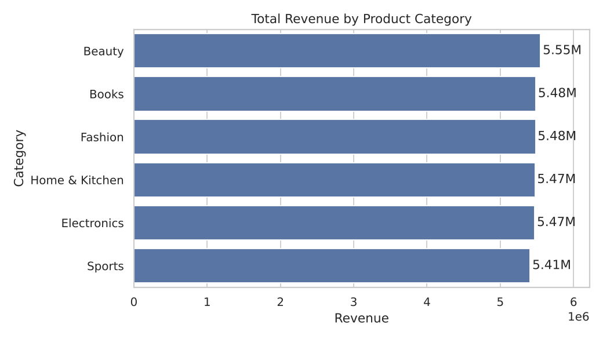
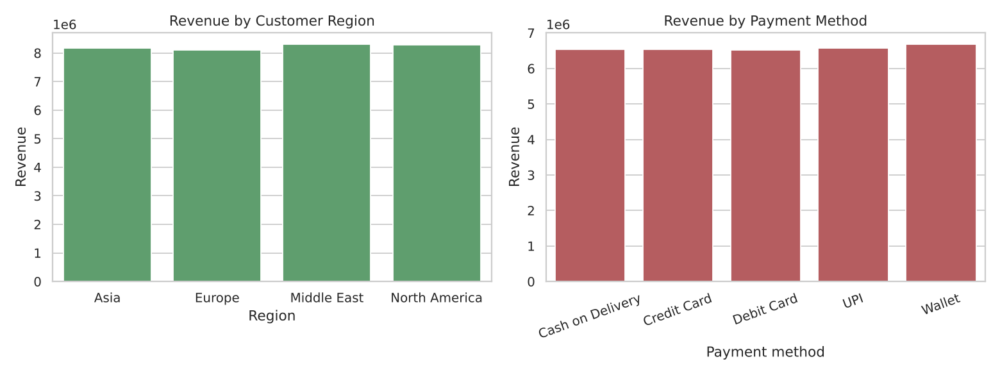
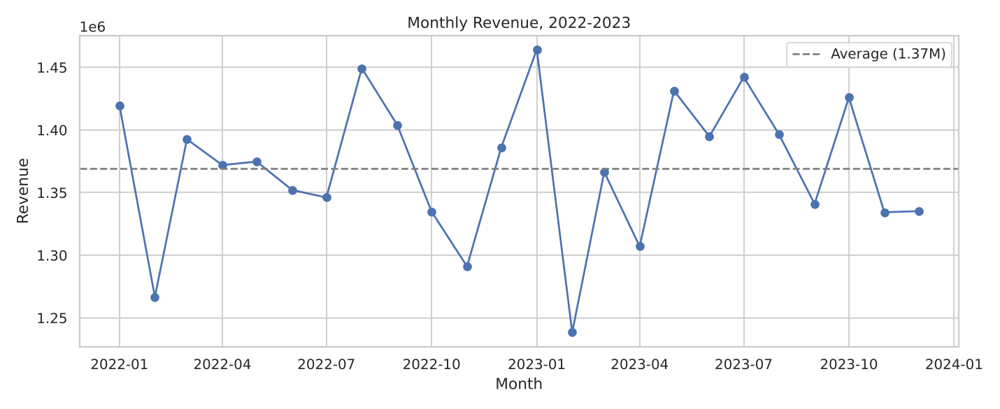
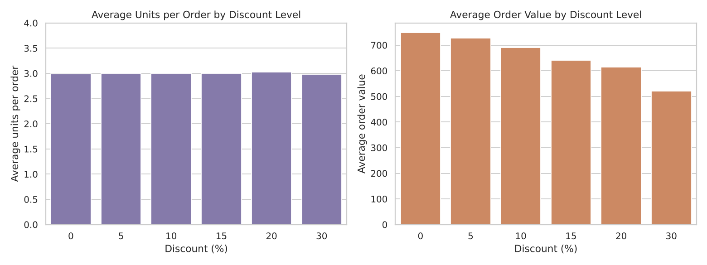
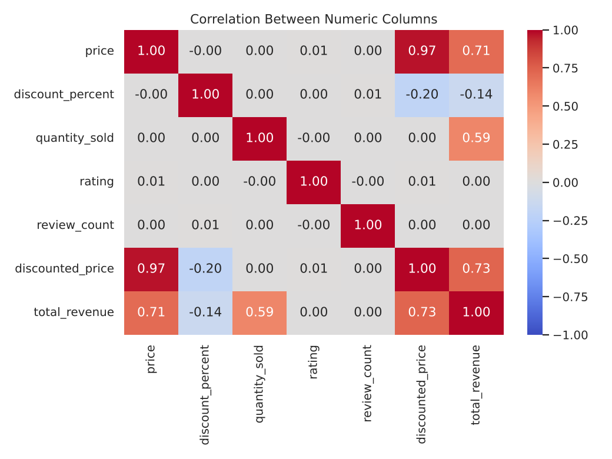
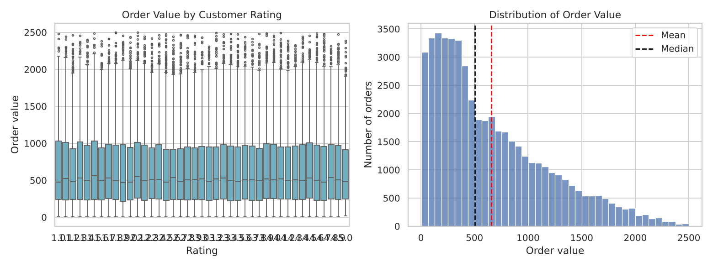
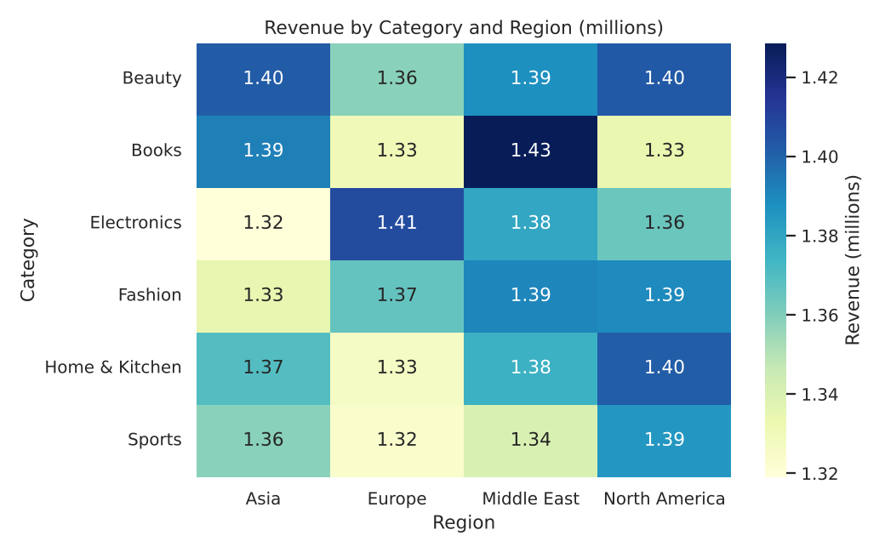

# Amazon Sales Analysis: Do Discounts Actually Pay Off?

## 1. Business Question
An online store sells in six product categories, four regions and five payment methods, with discounts of up to 30%. This project asks: where does the revenue come from, do bigger discounts make customers buy more, and do ratings have any link with sales?

## 2. Dataset
- **Name:** `amazon_sales_dataset.csv` 
- **Source:**(https://www.kaggle.com/datasets/aliiihussain/amazon-sales-dataset)
- **Size:** 50,000 rows and 13 columns, covering 1 Jan 2022 to 31 Dec 2023
- **Key columns:** `order_date`, `product_category` (6 values), `price`, `discount_percent` (0 to 30), `quantity_sold` (1 to 5), `customer_region` (4 values), `payment_method` (5 values), `rating` (1 to 5), `review_count`, `discounted_price`, `total_revenue`

## 3. Tools Used
Python 3, Jupyter Notebook, Pandas, NumPy, Matplotlib, Seaborn

## 4. Steps Followed
1. Defined the business question and described the dataset.
2. Loaded the CSV and inspected shape, data types and summary statistics.
3. Cleaned the data: no missing values, no duplicates, converted `order_date` to datetime and label columns to category, checked that price and revenue columns add up, and kept the high-value orders that the IQR rule flagged because they are real.
4. Explored the data with groupby tables (category, region, payment, discount, time) and a correlation matrix.
5. Made 7 charts with Matplotlib and Seaborn.
6. Wrote the insights and a conclusion.

## 5. Key Insights
1. **Discounts do not increase units bought.** About 3 units per order at every discount level, from 0% to 30%.
2. **So discounts mostly cost money.** Average order value drops from about 749 (no discount) to about 522 (30% discount). About 84% of orders had a discount, giving up roughly 13% of the list-price value of everything sold.
3. **Revenue is driven by price and quantity.** Correlation with revenue: price 0.71, quantity 0.59, discount -0.14.
4. **Categories are almost equal.** Beauty leads Sports by only about 2.7%.
5. **Regions and payment methods are almost equal too.** Differences are about 2% and too small to act on.
6. **The business is flat.** 2023 revenue is about 0.5% above 2022, with no clear seasonal peak.
7. **Ratings and review counts have no link with sales** (correlation about 0.00).
8. **Fridays are the strongest day**, about 6% above the Monday to Wednesday average.

**Note:** the data is unusually even across almost every column, which suggests it is simulated or sample data, so results should be checked on real sales data before making business decisions.

## 6.Visualizations

## 7. How to Run or Open
1. Keep the folder structure as it is ( `images/` next to the notebook).
2. Install the libraries: `pip install pandas numpy matplotlib seaborn jupyter`
3. Run `jupyter notebook` and open `Amazon_Sales_Analysis.ipynb`, then choose Kernel > Restart & Run All.
4. The notebook is already saved with all outputs visible, so GitHub shows the charts without running anything.

## 8. Author
 Sreeraj
